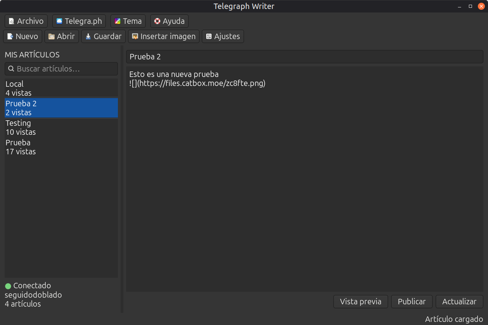

  

<h1 align="center">Telegraph Writer</h1>

  
  
  
  
  
  
  
  
  
  
  
  

## 🇪🇸 Español

  Escribe artículos en Markdown y publícalos en Telegra.ph, con vista previa fiel al resultado final.

  

Aplicación de escritorio (GTK 4 + PyGObject, interfaz en español e inglés), de uso personal: sin servidor propio ni cuenta
más allá de tu access token de Telegra.ph.

- **Escribe en Markdown** (encabezados, negrita, cursiva, tachado, subrayado, enlaces, imágenes, listas, citas,
  código) con una barra de formato, en lugar del editor web de Telegra.ph.
- **Vista previa fiel**, en un panel junto al editor que se actualiza mientras escribes, tal como quedará
  publicado (necesita `gir1.2-webkit-6.0`; sin él se abre en el navegador).
- **Publica y actualiza** artículos de tu cuenta de Telegra.ph, con protección contra crear un duplicado por
  error.
- **Guarda borradores** localmente en archivos Markdown, además de en Telegra.ph.
- **Sube imágenes** a [Catbox](https://catbox.moe/) e insértalas automáticamente en el artículo, porque
  Telegra.ph tiene deshabilitadas las subidas nuevas.
- **Modo claro y oscuro**, con los iconos del sistema en cada uno.
- **Disponible en español e inglés**, según el idioma del sistema (o `$LANGUAGE`).

## Documentación

Toda la documentación —instalación, guía de uso, especificaciones técnicas, solución de problemas y más— está en
la **[wiki del proyecto](https://github.com/seguidodoblado/telegraph-writer/wiki)** (español e inglés).

## Servicios de terceros

Telegraph Writer publica en tu propia cuenta de [Telegra.ph](https://telegra.ph/) mediante su API pública, con el
access token que tú mismo generas; la aplicación no aloja los artículos.

Las imágenes que insertas se suben a [Catbox](https://catbox.moe/), un servicio externo de alojamiento; quedan
fuera del control de la aplicación y sujetas a las condiciones de uso de Catbox.

## Privacidad

Telegraph Writer no tiene servidor ni cuenta propios y no recoge datos. Solo se comunica con Telegra.ph (para publicar y listar tus artículos) y con Catbox (para alojar las imágenes que subes). Qué se guarda y dónde está en la **[política de privacidad](PRIVACY.md)**.

## Licencia

Este proyecto se distribuye bajo la GNU General Public License, versión 3 o posterior (ver `COPYING`).

---

## 🇺🇸 English

  Write articles in Markdown and publish them to Telegra.ph, with a preview faithful to the final result.

  

Desktop application (GTK 4 + PyGObject, interface in Spanish and English), for personal use: no server of its own and
no account beyond your own Telegra.ph access token.

- **Write in Markdown** (headings, bold, italics, strikethrough, underline, links, images, lists, quotes, code)
  with a formatting toolbar, instead of Telegra.ph's own web editor.
- **Faithful preview**, in a panel next to the editor that updates while you type, exactly as it will be
  published (needs `gir1.2-webkit-6.0`; without it, it opens in the browser instead).
- **Publish and update** articles on your Telegra.ph account, with protection against accidentally creating a
  duplicate.
- **Save drafts** locally as Markdown files, in addition to Telegra.ph.
- **Upload images** to [Catbox](https://catbox.moe/) and insert them into the article automatically, since
  Telegra.ph has new uploads disabled.
- **Light and dark mode**, with the matching system icons in each.
- **Available in Spanish and English**, following the system's language (or `$LANGUAGE`).

## Documentation

Full documentation — installation, usage guide, technical specifications, troubleshooting and more — is in the
**[project wiki](https://github.com/seguidodoblado/telegraph-writer/wiki)** (Spanish and English).

## Third-party services

Telegraph Writer publishes to your own [Telegra.ph](https://telegra.ph/) account through its public API, using
the access token you generate yourself; the app doesn't host the articles.

Images you insert are uploaded to [Catbox](https://catbox.moe/), an external hosting service; they're outside the
app's control and subject to Catbox's own terms of use.

## Privacy

Telegraph Writer has no server or account of its own and collects no data. It only talks to Telegra.ph (to publish and list your articles) and to Catbox (to host the images you upload). What is stored and where is in the **[privacy policy](PRIVACY.md#-english)**.

## License

This project is distributed under the GNU General Public License, version 3 or later (see `COPYING`).
